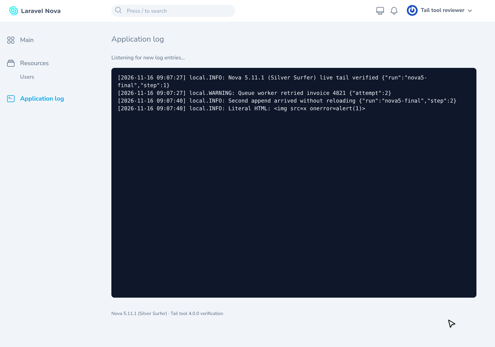

# A Laravel Nova tool to display the application log

[](https://packagist.org/packages/spatie/nova-tail-tool)
[](https://github.com/spatie/nova-tail-tool/actions/workflows/run-tests.yml)
[](https://packagist.org/packages/spatie/nova-tail-tool)

Have you always wanted to see your application log in your Nova app? Now you can!



You can see the tool in action in [this video on YouTube](https://www.youtube.com/watch?v=I_KvN_gLl9Q).

## Support us

[](https://spatie.be/github-ad-click/nova-tail-tool)

We invest a lot of resources into creating [best in class open source packages](https://spatie.be/open-source). You can support us by [buying one of our paid products](https://spatie.be/open-source/support-us).

We highly appreciate you sending us a postcard from your hometown, mentioning which of our package(s) you are using. You'll find our address on [our contact page](https://spatie.be/about-us). We publish all received postcards on [our virtual postcard wall](https://spatie.be/open-source/postcards).

## Installation

Version 4 requires PHP 8.4+, Laravel 13, and [Nova](https://nova.laravel.com) 5.11.1+. Older PHP, Laravel, and Nova versions are no longer supported. See [UPGRADING](UPGRADING.md) when upgrading from version 3.

Install the tool in a Laravel application with Nova already installed and authenticated:

```bash
composer require spatie/nova-tail-tool:^4.0
```

Next up, you must register the tool with Nova. This is typically done in the `tools` method of the `NovaServiceProvider`.

```php
// in app/Providers/NovaServiceProvider.php

// ...

public function tools(): array
{
   return [
        // ...
        new \Spatie\TailTool\TailTool(),
    ];
}
```

## Usage

Click "Application log" in Nova's menu. The tool listens for entries appended after you open the page, polling once per second. It reads the most recently modified `.log` file in `storage/logs`, including daily logs. Log rotation and truncation reset the cursor. Logs sent only to stderr or a remote service cannot be displayed.

Entries are displayed as plain text, including HTML. The browser keeps the latest 500,000 characters. Scrolling up stops automatic scrolling; "Scroll to bottom" resumes it. Failed requests show a connection message and retry automatically. Leaving the page stops polling.

Logs can contain sensitive information. Restrict access using Nova's `canSee` callback on the registered tool. The page and polling endpoint both enforce this callback and Nova authentication and authorization:

```php
(new \Spatie\TailTool\TailTool)
    ->canSee(fn ($request) => $request->user()->can('viewApplicationLogs')),
```

The page is available at `/nova/application-log`, or under your configured Nova path.

### Testing

``` bash
composer test
```

The test suite uses Pest 5 and the real Nova package. Configure Composer's Nova repository credentials before running `composer update`. CI requires two repository or organization secrets:

- `NOVA_USERNAME`: the Nova account email address.
- `NOVA_LICENSE_KEY`: a license key entitled to download Nova 5.11.1.

The workflow configures Composer authentication from these secrets. No JSON secret is needed.

### Building assets

```bash
npm ci
npm run build
```

Commit the rebuilt `dist` files. Applications using the package do not need Node.js. The Vue 3 components use Nova's own Vue runtime, with Vite replacing Laravel Mix.

### Changelog

Please see [CHANGELOG](CHANGELOG.md) for more information on what has changed recently.

## Contributing

Please see [CONTRIBUTING](https://github.com/spatie/.github/blob/main/CONTRIBUTING.md) for details.

### Security

If you've found a bug regarding security please mail [security@spatie.be](mailto:security@spatie.be) instead of using the issue tracker.

## Credits

- [Freek Van der Herten](https://github.com/freekmurze)
- [Sebastian De Deyne](https://github.com/sebastiandedeyne)
- [All Contributors](../../contributors)

## License

The MIT License (MIT). Please see [License File](LICENSE.md) for more information.
